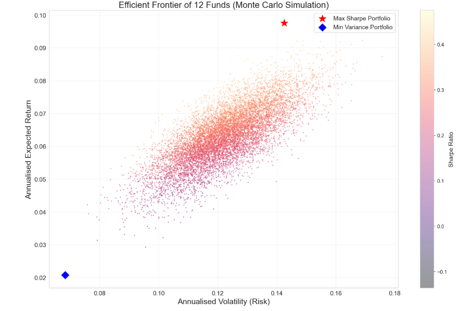
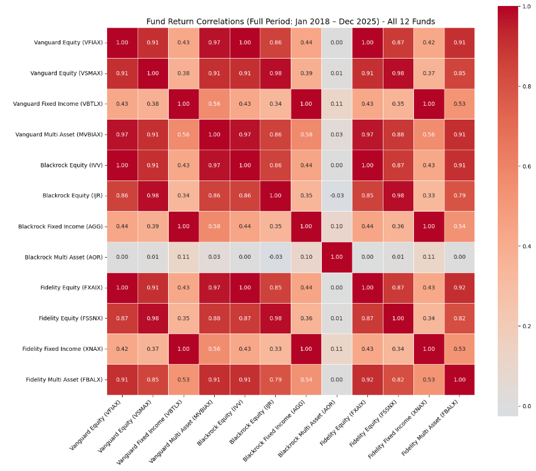

# Performance and Risk Analysis of International Mutual Funds Using Data Analytics

## Project Overview

This project analyses the performance and risk characteristics of selected international mutual funds managed by Vanguard Group, BlackRock-iShares, and Fidelity Investments.

The study uses monthly Net Asset Value (NAV) and fund-level financial data covering January 2016 to December 2025. It applies risk-adjusted performance measures, factor-model analysis, stress-period analysis, and Monte Carlo simulation to evaluate fund behaviour across different market conditions.

## Research Objectives

- Compare the risk-adjusted performance of selected funds across equity, fixed-income, and multi-asset categories.
- Assess fund sensitivity to major financial stress events.
- Compare passive and actively managed funds on a risk-adjusted basis.
- Construct an optimal multi-manager portfolio using Monte Carlo simulation.
- Examine fund performance across different market environments.

## Fund Families

The analysis covers three major U.S.-based asset management institutions:

- Vanguard Group
- BlackRock-iShares
- Fidelity Investments

The study considers funds across multiple categories, including large-cap equity, small-cap equity, fixed income, and multi-asset/balanced funds.

## Study Period

**January 2016 – December 2025**

Monthly NAV and return data are used to evaluate long-term performance and behaviour during selected periods of financial stress.

## Analytical Framework

The project applies a multi-dimensional analytical framework consisting of:

1. Descriptive and return analysis
2. Risk-adjusted performance evaluation
3. Factor-model regression
4. Correlation and stress-period analysis
5. Passive versus active fund comparison
6. Monte Carlo simulation-based portfolio optimisation

## Performance and Risk Metrics

The analysis includes traditional measures of investment performance and risk, including:

- Sharpe Ratio
- Treynor Ratio
- Jensen's Alpha
- Information Ratio
- Beta
- Tracking Error
- Standard Deviation
- Return Analysis

## Python Analysis

The Python analysis was conducted using Jupyter Notebook and includes correlation analysis and Monte Carlo-based portfolio optimisation.

[View Python Analysis](Python/mutual_fund_analysis.ipynb)

### Python Outputs

- Efficient Frontier using Monte Carlo simulation
- Correlation heatmap of fund returns

## Stress-Period Analysis

Fund performance is examined during major market stress events, including:

- U.S.-China Trade War (2018–2019)
- COVID-19 Market Crisis (2020)
- Federal Reserve Rate Hiking Cycle / 2022 Rate Shock

The analysis evaluates how different fund categories behaved under changing market conditions and elevated financial stress.

## Factor Analysis

Factor-based analysis is used to examine the sources of fund returns and their sensitivity to systematic market factors.

The research considers established asset-pricing frameworks including the Fama-French and Carhart factor models.

## Monte Carlo Portfolio Optimisation

Monte Carlo simulation is used to generate alternative portfolio combinations and identify allocations that provide favourable risk-adjusted performance under different market conditions.

The analysis includes 50,000 simulated portfolio combinations.

## Power BI Dashboard

The project includes Power BI visualisations developed to compare fund performance, risk-adjusted returns, stress-period behaviour, and portfolio allocation.

### Key Visualisations

#### Sharpe Ratio Comparison

#### Risk vs Return Analysis

#### Stress-Period Performance

#### Optimal Portfolio Allocation

### Power BI File

The complete Power BI dashboard is available here:

[`mutual_fund_dashboard.pbix`](PowerBI/mutual_fund_dashboard.pbix)

## Project Files

- `mutual_fund_analysis.xlsx` - Excel workbook containing the project data, calculations, performance metrics, stress-period analysis, and portfolio simulation results.
- `Performance_and_Risk_Analysis_...pdf` - Full dissertation documenting the research methodology, analysis, findings, and conclusions.

## Tools and Technologies

- Microsoft Excel
- Python
- Jupyter Notebook
- Pandas
- NumPy
- Matplotlib
- Seaborn
- Excel
- Power BI
- Financial Analytics
- Statistical Analysis
- Portfolio Analysis

## Academic Context

**M.Sc. Banking & Financial Analytics**  
Jamia Millia Islamia, New Delhi

**Author:** Syed Faisal Andrabi

## Disclaimer

This project is intended for academic and analytical purposes. The results should not be interpreted as investment advice or a recommendation to buy or sell any financial security.
